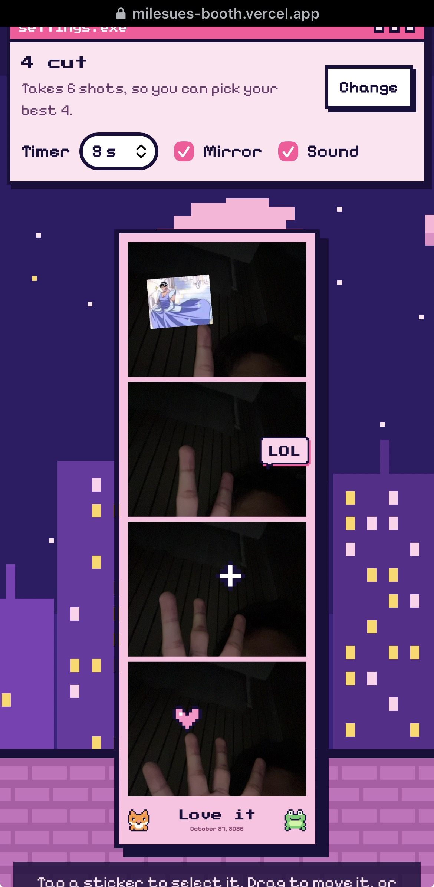

# Milesue's Booth

**A free 8-bit photobooth that runs in your browser.** Pick a layout, pose, pick your best shots, add stickers, and save your strip, with no fees and no watermark. Everyone in the photo can scan a QR code to get it on their own phone.

Hosted by an orange cat and a frog in a pink pixel night city. 🐱🐸

**▶ Try it live: [milesues-booth.vercel.app](https://milesues-booth.vercel.app)**

<p align="center">
  
</p>

## Features

- **Pick a layout:** Polaroid, 2 cut, 4 cut strip, 2 × 2, 6 cut or 8 cut. The booth takes **2 extra shots** so you can choose your best ones.
- **Pick your best:** tap photos in the order you want them on the strip.
- **8-bit countdown** with a flash and retro beeps
- **Flash light:** uses the phone's torch when the camera has one, or lights up the screen for selfies
- **Stickers:** pixel art (cat, frog, heart, star, crown, shades and more) and Filipino meme words (SANA ALL, CHAROT, LODI, OMG…)
- **Your own stickers:** add any picture from your device and use it as a sticker
- **Sticker editing:** drag to move, drag the corner to resize and turn, or use the buttons and keyboard
- **6 filters**, **5 frame colors**, an optional caption and the date
- **Save as PNG**, or **Share** straight to apps on phones
- **QR code:** everyone in the photo scans it and saves the strip on their own phone (optional, see below)
- **No camera?** Use photos from your device instead
- Switch between front and back cameras on phones

## Privacy

Your camera, photos and stickers stay in your browser and disappear when you close the tab. The saved image goes straight to your device.

The only time anything leaves the device is when you tap **Get QR code** and agree. Then that one finished strip is uploaded to the booth owner's Supabase storage so friends can download it. Anyone with the QR code or link can open it.

## Turn on QR code sharing (optional, about 5 minutes)

The QR button stays hidden until you do this. Use a **new, free Supabase project** just for the booth.

1. Create a project at [supabase.com](https://supabase.com).
2. **Storage → New bucket:** name it `strips`, turn **Public bucket** on, set the file size limit to `10 MB` and allowed types to `image/png`.
3. **SQL Editor:** run this so visitors can upload strips (but not list, change or delete them):

   ```sql
   create policy "Anyone can upload photo strips"
   on storage.objects for insert to anon
   with check (bucket_id = 'strips');
   ```

4. Copy two things into `js/config.js`:
   - **Project URL:** `https://YOUR-PROJECT-ID.supabase.co` (the Project ID is in **Settings → General**)
   - **Publishable key:** **Settings → API Keys**, the key starting with `sb_publishable_` (an older project's **anon** key also works). Never use the **secret** key here.

Each strip gets a long random file name, so links can't be guessed. Old strips stay in the bucket until you delete them in **Storage → strips** (files are grouped in folders by date).

When you test on `localhost`, the QR code points straight to the image, because phones can't open your computer's localhost. On the real website, it opens `get.html`, a page with a **Save photo** button.

## Run it locally

Browsers only allow the camera on `https` or `localhost`, so use a small local server:

```bash
python -m http.server 5500
```

Then open **http://localhost:5500**.

## Deploy

It's a static site with no build step:

- **Vercel:** import the repo and deploy (no settings needed)
- **GitHub Pages:** Settings → Pages → deploy from the `main` branch

## How it works

| File | What it does |
|---|---|
| `index.html` | Page structure |
| `css/style.css` | The 8-bit pink look |
| `js/pixel.js` | All the pixel art, drawn in code: the cat, the frog, sticker sprites, word bubbles, and the night-city background |
| `js/app.js` | Camera, flash light, countdown, picking your best, saving |
| `js/compose.js` | Builds the card for each layout (Polaroid to 8 cut) |
| `js/stickers.js` | The sticker editor: add, drag, resize, turn, delete |
| `js/share-qr.js` | Uploads the strip (only when asked) and draws the QR code |
| `js/config.js` | Your Supabase settings for QR sharing |
| `get.html` | The page friends open from the QR code |
| `js/vendor/qrcode.js` | [qrcode-generator](https://github.com/kazuhikoarase/qrcode-generator) by Kazuhiko Arase (MIT) |
| `js/filters.js` | Filters, with a pixel fallback for older Safari |

Built with plain HTML, CSS and JavaScript using the browser's camera API (`getUserMedia`), Canvas and Web Audio. No frameworks; the only library is a small QR code generator. All the pixel art is original and drawn in code.

## Credits

- Fonts: [Press Start 2P](https://github.com/codeman38/PressStart2P) and [Pixelify Sans](https://github.com/eifetx/Pixelify-Sans), both under the SIL Open Font License (see `fonts/`).

## License

MIT © Genesis Ver R. Florento
